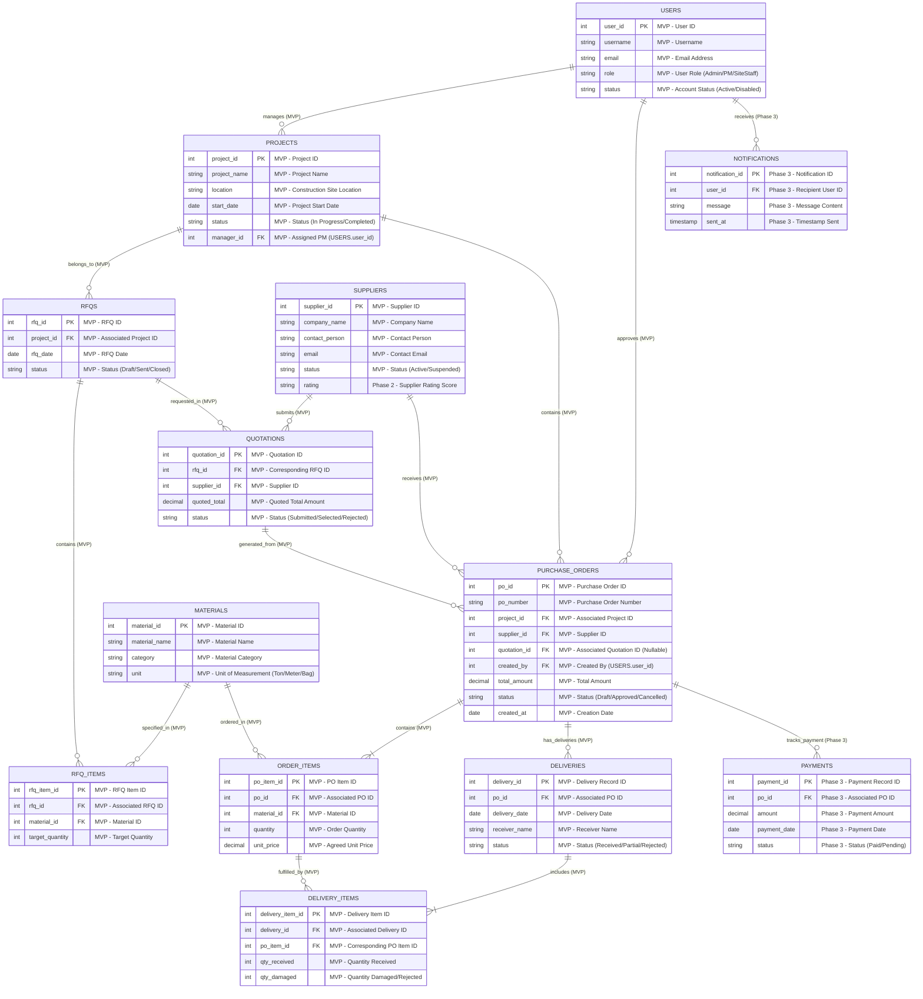

# DISupplier - 3NF Data Model (ER Diagram)

This document defines the database schema for the DISupplier Procurement and Supplier Management Platform in 3rd Normal Form (3NF). It visually distinguishes the Minimum Viable Product (MVP / Phase 1) scope from advanced features (Phase 2/3).

