# DISupplier
### Description: 

DISupplier is a web-based supplier and procurement management platform developed to help construction companies improve the management of suppliers, procurement processes, quotations, purchase orders, deliveries, and supplier performance across multiple construction projects. The software was developed by Digital Idea Solution Co., Ltd. as a solution to reduce fragmented procurement processes and improve coordination, visibility, and decision-making within construction projects.

### Developers:
| Name | Student ID |
| ----- | ---------- |
| Ambrosius Matthew Junius Reynaldo | D11505806 |
| 林宗群 | M11505501 |

### Planned Website:

This is the organizational chart for Digital Idea Solution Website and DISupplier

```mermaid

flowchart LR

    %% Style Definition
    classDef highPriority fill:#ff9999,stroke:#333,stroke-width:2.5px,color:#fff; 
    classDef medPriority fill:#ffcc99,stroke:#333,stroke-width:2.5px,color:#fff; 
    classDef lowPriority fill:#99ccff,stroke:#333,stroke-width:2.5px,color:#fff;
    classDef coreWeb fill:#243447,stroke:#4da3ff,stroke-width:3px,color:#fff;
    classDef publicWeb fill:#2f3542,stroke:#4da3ff,stroke-width:3px,color:#fff;

    %% Website Entry
    A[Digital Idea Solution <br> Website]

    %% Public Website (B for Public)
    subgraph Public["Public Website"]
        direction TB
        B1["Homepage<br/>(Matthew)"]
        B2["Solutions<br/>(Matthew)"]
        B3["Who We Serve<br/>(林宗群)"]
        B4["Pricing<br/>(林宗群)"]
        B5["Our Story<br/>(Matthew)"]
        L["Login<br/>(Matthew)"]
        B6["Contact Us<br/>(林宗群)"]
        B7["Join Our Team<br/>(林宗群)"]
    
    end

%% DISupplier Core Platform Subgraph (Post-Login)
    subgraph CoreSystem["DISupplier Core Platform"]
        direction TB
        C1["Dashboard<br/>(林宗群)"]

        C2["User Management<br/>(林宗群)"]
        C2_1["🆕<br/>Create User<br/>(林宗群)"]
        C2_2["👤<br/>Assign User Roles<br/>(林宗群)"]
        C2_3["🔍<br/>View User<br/>(林宗群)"]
        C2_4["📝<br/>Edit User<br/>(林宗群)"]
        C2_5["🔐<br/>Change Permissions<br/>(林宗群)"]
        C2_6["⛔<br/>Deactivate User<br/>(林宗群)"]

        C3["Project Management<br/>(林宗群)"]
        C3_1["🆕<br/>Create Project<br/>(林宗群)"]
        C3_2["🔍<br/>View Project<br/>(林宗群)"]
        C3_3["📝<br/>Edit Project<br/>(林宗群)"]
        C3_4["🧾<br/>List Projects<br/>(林宗群)"]
        C3_5["👥<br/>Assign Project Manager and Team<br/>(林宗群)"]
        
        C4["Supplier Management<br/>(Matthew)"]
        C4_1["🆕<br/>Add Supplier<br/>(Matthew)"]
        C4_2["🔍<br/>View Supplier<br/>(Matthew)"]
        C4_3["📝<br/>Edit Supplier<br/>(Matthew)"]
        C4_4["🧾<br/>List Suppliers<br/>(Matthew)"]
        C4_5["⛔<br/>Suspend/Deactivate Supplier<br/>(Matthew)"]
        C4_6["🏢<br/>Manage Supplier Company<br/>(Matthew)"]

        C5["Procurement and Quotation Management<br/>(Matthew)"]
        C5_1["📩<br/>Manage RFQ<br/>(Matthew)"]
        C5_1_1["🆕<br/>Create RFQ<br/>(Matthew)"]
        C5_1_2["📦<br/>Select Materials and Suppliers for RFQ<br/>(Matthew)"]
        C5_1_3["📤<br/>Send RFQ<br/>(Matthew)"]
        C5_2["📄<br/>Manage Quotation<br/>(Matthew)"]
        C5_2_1["🔍<br/>Receive and View Quotation<br/>(Matthew)"]
        C5_2_2["⚖️<br/>Compare and Evaluate Quotation<br/>(Matthew)"]
        C5_2_3["🏭<br/>Select Supplier<br/>(Matthew)"]
        C5_3["🛒<br/>Manage Purchase Order<br/>(Matthew)"]
        C5_3_1["🆕<br/>Create Purchase Order<br/>(Matthew)"]
        C5_3_2["🔍<br/>View Purchase Order<br/>(Matthew)"]
        C5_3_3["✅<br/>Approve Purchase Order<br/>(Matthew)"]
        C5_3_4["❌<br/>Revise/Cancel Purchase Order<br/>(Matthew)"]

        C6["Site Operation Management<br/>(Matthew)"]
        C6_1["🚚<br/>Manage Material Delivery<br/>(Matthew)"]
        C6_1_1["🔍<br/>View Expected Delivery<br/>(Matthew)"]
        C6_1_2["✅<br/>Confirm Delivery<br/>(Matthew)"]
        C6_1_3["🗂️<br/>Record Quantity Recieved<br/>(Matthew)"]
        C6_1_4["🗂️<br/>Record Damaged and Rejected Items<br/>(Matthew)"]
        C6_2["🦺<br/>Manage Site Requirements<br/>(Matthew)"]
        C6_2_1["🗂️<br/>Record Material Shortage<br/>(Matthew)"]
        C6_2_2["🗂️<br/>Record Material Usage<br/>(Matthew)"]

        C7["Material Management<br/>(林宗群)"]
        C7_1["🆕<br/>Add Material<br/>(林宗群)"]
        C7_2["🔍<br/>View Material<br/>(林宗群)"]
        C7_3["📝<br/>Edit Material<br/>(林宗群)"]
        C7_4["🧾<br/>List MaterialS<br/>(林宗群)"]

        C8["Supplier Performance Evaluation<br/>(Matthew)"]
        C8_1["📑<br/>Basic Report<br/>(Matthew)"]
        C8_2["🔮<br/>Advanced Predictive Analysis<br/>(Matthew)"]
        C8_3["💡<br/>Generate Supplier Recommendations<br/>(Matthew)"]

        C9["Financial Management<br/>(林宗群)"]
        C9_1["💳<br/>Manage Project Order and Payment<br/>(林宗群)"]
        C9_1_1["🔍<br/>View Purchase Order<br/>(林宗群)"]
        C9_1_2["🔍<br/>View and Record Payment Status<br/>(林宗群)"]
        C9_2["💰<br/>Manage Project Financial<br/>(林宗群)"]
        C9_2_1["📊<br/>Track Procurement Cost<br/>(林宗群)"]
        C9_2_2["🔍<br/>View Project Procurement Expenditure<br/>(林宗群)"]

        C10["Notification Management<br/>(Matthew)"]
        C10_1["🔔<br/>System Notification<br/>(Matthew)"]
        C10_2["⏰<br/>Automated Alerts<br/>(Matthew)"]
        C10_3["💬<br/>Integrated Messaging Application<br/>(Matthew)"]
    end

%% Connections
A --> Public

L --> C1

C1 --> C2
C1 --> C3
C1 --> C4
C1 --> C5
C1 --> C6
C1 --> C7
C1 --> C8
C1 --> C9
C1 --> C10

C2 --> C2_1
C2 --> C2_2
C2 --> C2_3
C2 --> C2_4
C2 --> C2_5
C2 --> C2_6

C3 --> C3_1
C3 --> C3_2
C3 --> C3_3
C3 --> C3_4
C3 --> C3_5

C4 --> C4_1
C4 --> C4_2
C4 --> C4_3
C4 --> C4_4
C4 --> C4_5
C4 --> C4_6

C5 --> C5_1
C5_1 --> C5_1_1
C5_1 --> C5_1_2
C5_1 --> C5_1_3
C5 --> C5_2
C5_2 --> C5_2_1
C5_2 --> C5_2_2
C5_2 --> C5_2_3
C5 --> C5_3
C5_3 --> C5_3_1
C5_3 --> C5_3_2
C5_3 --> C5_3_3
C5_3 --> C5_3_4

C6 --> C6_1
C6_1 --> C6_1_1
C6_1 --> C6_1_2
C6_1 --> C6_1_3
C6_1 --> C6_1_4
C6 --> C6_2
C6_2 --> C6_2_1
C6_2 --> C6_2_2

C7 --> C7_1
C7 --> C7_2
C7 --> C7_3
C7 --> C7_4

C8 --> C8_1
C8 --> C8_2
C8 --> C8_3

C9 --> C9_1
C9_1 --> C9_1_1
C9_1 --> C9_1_2
C9 --> C9_2
C9_2 --> C9_2_1
C9_2 --> C9_2_2

C10 --> C10_1
C10 --> C10_2
C10 --> C10_3

linkStyle default stroke:#5bc0eb,stroke-width:1.5px

%% Priority Legend 
    subgraph Legend [Priority Legend]
        direction TB
        P1["High Priority<br>MVP (Core Features)<br>Phase 1"]
        P2["Medium Priority<br>Feature Development<br>Phase 2"]
        P3["Low Priority<br>Feature Development<br>Phase 3"]
    end

%% Assign Classes to Nodes 
class B1,B2,L,C1,C2,C2_1,C2_2,C2_3,C2_4,C2_5,C2_6,C3,C3_1,C3_2,C3_3,C3_4,C3_5,C4,C4_1,C4_2,C4_3,C4_4,C4_5,C4_6,C5,C5_3,C5_3_1,C5_3_2,C5_3_3,C5_3_4,C6,C6_1,C6_1_1,C6_1_2,C6_1_3,C6_1_4,C6_2,C6_2_1,C6_2_2,C7,C7_1,C7_2,C7_3,C7_4,C8,C8_1,P1 highPriority; 
class B3,B4,B5,C5_1,C5_1_1,C5_1_2,C5_1_3,C5_2,C5_2_1,C5_2_2,C5_2_3,P2 medPriority;
class B6,B7,C8_2,C8_3,C9,C9_1,C9_1_1,C9_1_2,C9_2,C9_2_1,C9_2_2,C10,C10_1,C10_2,C10_3,P3 lowPriority;
class A publicWeb;

%% Apply Style to Subgraph
style Public fill:#2f3542,stroke:#f4c95d,stroke-width:3px,color:#fff
style CoreSystem fill:#30343b,stroke:#4da3ff,stroke-width:3px,color:#fff

```

#### Priority Legend:
- 🟥 **High Priority (MVP - Phase 1)**  
Red boxes = Essential core functions required for system operation

- 🟨 **Medium Priority (Feature Development - Phase 2)**  
Yellow Boxes = Additional features that improve functionality and user experience

- 🟦 **Low Priority (Feature Development - Phase 3)**  
Blue Boxes = Future enhancements and advanced features

### 🗄️ Database Architecture & ER Model 

Our relational database is strictly designed in **Third Normal Form (3NF)** to eliminate data redundancy and ensure transactional integrity across procurement workflows.

- **MVP ER Diagram**: Focuses on the core database entities supporting user management, material management, supplier management, delivery tracking, and basic supplier performance evaluation  
👉 **View the complete MVP 3NF ER Diagram and Data Dictionary in [\`ERModel_MVP.md\`](./ERModel_MVP.md)**

- **Full Version ER Diagram**: Extends the MVP database with additional entities supporting financial and payment management, procurement and quotation management, notifications, supplier performance reporting, and predictive supplier analysis.   
👉 **View the complete Full Version 3NF ER Diagram and Data Dictionary in [\`ERModel_FullVersion.md\`](./ERModel_FullVersion.md)**
